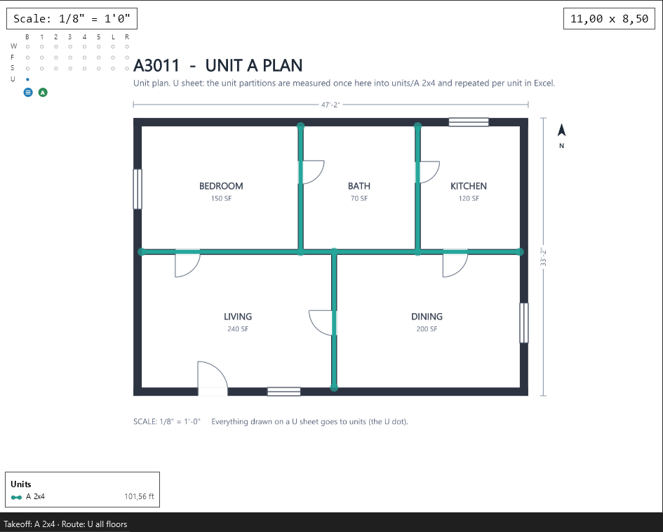

# Unit Walls

<figure markdown>
  
  <figcaption markdown="span">Unit type sheet `a3011 u` in the demo project: the U dot is lit, the status reads `Route: U all floors`, every new takeoff from the sheet goes into `units`. The `A 2x4` lines run only on the interior partitions of the unit, one takeoff per size; the `Units` legend gives 101,56 ft.</figcaption>
</figure>

## What it is

Unit walls are the interior partitions of **one typical unit**. Units
repeat, so the walls of one type are measured once on the enlarged
unit plan, and the number of repeats is taken separately. Exterior, corridor and
demising walls are not part of the unit: they are counted on the floor plan
([Exterior](exterior.md), [Corridor](corridor.md), [Demising](demising.md)).

## Where to find it on the plans

| Sheet | What to take |
| --- | --- |
| Unit plans `a3011 u` (scale usually 1/4") | Partitions of types A, B1, B1A; size by the thickness on the plan: 3 1/2" = 2x4, 5 1/2" = 2x6 |
| Unit matrix, keyplan, floor plans `a101 1st` | How many times and on which floors each type occurs, mirrored versions |
| Wall type schedule (`wt`) | What the partitions are: wood or metal studs, spacing, rated walls |
| Interior elevations `in el`, RCP | Blocking for kitchen and bath, dropped soffit |
| Door schedule | Interior doors and their jambs by the size of the adjacent wall |

## How to measure in OurPlanCore

**Line** tool, LFT unit, on the unit sheet.

1. The sheet name ends in `u` (`a3011 u`): the sheet gets the **U** dot, and any
   new takeoff from it goes straight into `units`. Set the floor or type subfolder
   by moving it.
2. One takeoff per type and size: `A 2x4`, `A 2x6`, `B1A 2x4`. A mirrored
   repeat is the same type; a really different version (shaft, accessibility, different
   ceiling) is its own type.
3. Run a line along the centerline of each interior partition of the unit. A wall with no mark on
   the types sheet follows its neighbors.
4. Fix the boundary with common walls once: a partition must not end up
   both in `units` and in `walls/<floor> floor walls`.
5. Repeats are a separate count, not a number of lines: Count points on the floor plan,
   name = unit mark (`B1`, `B1A`), one point per unit.
6. Sort the sheet legend with `Organize > Sort Sheet Legend by Key (before space)`:
   `A1 2x4, A1 2x6, A2 2x4, B1 2x4, B1A 2x4`.

If the unit partitions are metal studs or `walls are panels by others`, the walls
are still marked up, but the DFL gets `0` and a scope note
([Metal Tracks](metal-tracks.md), [Wall Panels](wall-panels.md)).

## Takeoff name and DFL row

| Takeoff name | DFL row | Unit | Formula / factor |
| --- | --- | --- | --- |
| `units/A 2x4` | `Studs Interior` `2x4` | pieces, D = stud length | `LFT x repeats x 1.1` (16") |
| `units/A 2x6` | `Studs Interior` `2x6` | pieces, D = stud length | the same, 24" = 0.625 |
| same | `Plates Interior (1) btm`, `(2) dbl top` | LFT | `LFT x repeats x 1.1`, dbl top also `x 2`; btm P.T. only on concrete |
| same | `Blocking` | LFT | from the template matrix, rounded to even |
| `B1` (Count on the floor plan) | repeat multiplier | ea | number of units of that type on the floor |

Unit partitions get no bracing row: the template has `Bracing` only for
ext, corridor and demising walls (in pieces, see [Corridor](corridor.md)).

The `UN` button on the XL strip puts the unit table into the workbook (AM3) with totals by
floor; the `C_UnitTable` macro multiplies the unit lengths by the number of repeats.
Per unit there is also kitchen blocking (`2x6`, 4 at 14') and bath blocking (`2x6`,
1 at 14'), jamb blocking for interior doors and dropped soffit from the RCP. Interior
drywall, interior insulation and sound batts are not counted in the frame scope.

## Common mistakes

- Repeats multiplied twice: the geometry was copied and a factor was applied too.
- A demising or corridor wall ended up inside the unit and was counted again on the floor.
- Types A1 and A10 from the previous building carried over to a new job without the matrix.
- `24" o.c.` spacing copied although the spec calls for `16" o.c.`.
- Interior door jamb taken as generic instead of by the size of the adjacent wall.
- The `u` tag is not last in the sheet name (`a301 u el`): no U dot, the lines went into `walls`.

Walkthrough with examples: [all wall mistakes](../../../start/common-mistakes.md#walls).

## Example

```text
units/
  A 2x4      Line, 58.7 LFT
  A 2x6      Line, 3.1 LFT
  B1 2x4     Line, 71.2 LFT
  B1A 2x4    Line, 74.0 LFT
walls/1st floor walls/
  B1         Count, 6 ea      (repeats of type B1 on the 1st floor)
```

## See also

- [Corridor Walls](corridor.md), [Demising Walls](demising.md)
- [Windows and Doors](../openings/windows-doors.md): interior doors and jambs
- [U sheet dot](../../../reference/takeoff-naming.md#sheet-dots), [legend order](../../../reference/takeoff-naming.md#legend-order)
- [Formulas: stud factors](../../../reference/formulas.md#stud-spacing-factors)
