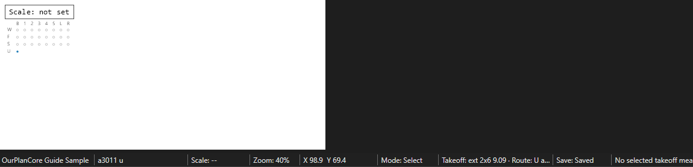

# Unit Walls (стены типовых квартир)

<figure markdown>
  
  <figcaption markdown="span">Лист типа юнита с точкой U: все новые takeoff с него ложатся в `units`. Линии только по внутренним перегородкам квартиры, по одной позиции на сечение.</figcaption>
</figure>

## Что это

Unit walls - внутренние перегородки **одной типовой квартиры**. Квартиры
повторяются, поэтому стены одного типа меряются один раз на увеличенном
плане юнита, а число повторов берётся отдельно. Наружные, коридорные и
demising стены в юнит не входят: они считаются на плане этажа
([Exterior](exterior.md), [Corridor](corridor.md), [Demising](demising.md)).

## Где искать на чертежах

| Лист | Что взять |
| --- | --- |
| Планы юнитов `a3011 u` (масштаб обычно 1/4") | Перегородки типа A, B1, B1A; сечение по толщине на плане: 3 1/2" = 2x4, 5 1/2" = 2x6 |
| Unit matrix, keyplan, планы этажей `a101 1st` | Сколько раз и на каких этажах встречается каждый тип, зеркальные варианты |
| Wall type schedule (`wt`) | Из чего перегородки: дерево или metal studs, шаг, rated стены |
| Interior elevations `in el`, RCP | Blocking под кухню и ванную, dropped soffit |
| Door schedule | Межкомнатные двери и их jambs по сечению соседней стены |

## Как мерить в OurPlanCore

Инструмент **Line**, единица LFT, на листе юнита.

1. Имя листа кончается на `u` (`a3011 u`): лист получает точку **U**, и любой
   новый takeoff с него ложится прямо в `units`. Подпапку этажа или типа
   задаёшь переносом (move).
2. Одна позиция на тип и сечение: `A 2x4`, `A 2x6`, `B1A 2x4`. Зеркальный
   повтор - тот же тип; реально другой вариант (шахта, доступность, другой
   потолок) - свой тип.
3. Линия по оси каждой внутренней перегородки юнита. Стена без марки на
   листе типов - по соседним.
4. Граница с общими стенами фиксируется один раз: перегородка не должна попасть
   и в `units`, и в `walls/<этаж> floor walls`.
5. Повторы - отдельный счёт, не число линий: Count точками на плане этажа,
   имя = марка юнита (`B1`, `B1A`), одна точка на квартиру.
6. Легенду листа сортируй `Organize > Sort Sheet Legend by Key (before space)`:
   `A1 2x4, A1 2x6, A2 2x4, B1 2x4, B1A 2x4`.

Если перегородки юнитов - metal studs или `walls are panels by others`, стены
всё равно размечаются, а в DFL ставится `0` и нота по scope
([Metal Tracks](metal-tracks.md), [Wall Panels](wall-panels.md)).

## Как назвать в дереве и строка DFL

| Имя в дереве | Строка DFL | Unit | Формула / фактор |
| --- | --- | --- | --- |
| `units/A 2x4` | `Studs Interior 2x4` | pcs | `LFT x повторы x 1.1` (16") |
| `units/A 2x6` | `Studs Interior 2x6` | pcs | то же, 24" = 0.625 |
| то же | `Plates Interior (1) btm`, `(2) dbl top` | LFT | `LFT x повторы x 1.1`; btm P.T. только на бетоне |
| то же | `Blocking`, `Bracing` | LFT | по типу стены |
| `B1` (Count на плане этажа) | множитель повторов | ea | число квартир типа на этаже |

Кнопка `UN` полосы XL ставит таблицу юнитов в книгу (AM3) с итогами по
этажам; макрос `C_UnitTable` умножает длины юнита на число повторов.
Отдельно по юниту идут blocking кухни (`2x6`, 4 по 14') и ванной (`2x6`,
1 по 14'), jamb blocking межкомнатных дверей и dropped soffit с RCP. Внутренний
гипсокартон, внутренний утеплитель и sound batt во frame-scope не считаем.

## Частые ошибки

- Повторы умножены дважды: и скопирована геометрия, и поставлен коэффициент.
- Demising или corridor стена попала внутрь юнита и посчитана ещё раз на этаже.
- Типы A1 и A10 из прошлого дома перенесены на новый проект без матрицы.
- Шаг `24" o.c.` скопирован, хотя spec требует `16" o.c.`.
- Jamb межкомнатной двери взят generic, а не по сечению соседней стены.
- Тег `u` не последний в имени листа (`a301 u el`): точки U нет, линии ушли в `walls`.

Разбор с примерами: [все ошибки по стенам](../../../start/common-mistakes.md#walls).

## Пример

```text
units/
  A 2x4      Line, 58.7 LFT
  A 2x6      Line, 3.1 LFT
  B1 2x4     Line, 71.2 LFT
  B1A 2x4    Line, 74.0 LFT
walls/1st floor walls/
  B1         Count, 6 ea      (повторы типа B1 на 1-м этаже)
```

## См. также

- [Corridor Walls](corridor.md), [Demising Walls](demising.md)
- [Windows and Doors](../openings/windows-doors.md): межкомнатные двери и jambs
- [Точка листа U](../../../reference/takeoff-naming.md#sheet-dots), [порядок легенды](../../../reference/takeoff-naming.md#legend-order)
- [Формулы: stud factors](../../../reference/formulas.md#stud-spacing-factors)
