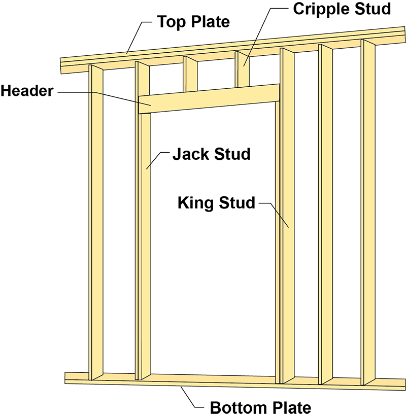

# Wall Panels: what we count

<figure markdown>
  { width="760" style="background:#fff;padding:12px;border-radius:8px" }
  <figcaption markdown="span">Wall panel makeup: plates, studs, opening framing, sometimes sheathing and WRB. SBCA illustration. What exactly is in the supply is decided by the job, not by the picture.</figcaption>
</figure>

## What it is

A wall panel is a factory-built wall section (studs, plates, opening framing, often
one side of sheathing and WRB). On a panel job we do not duplicate the factory
framing; we count the loose scope and the stick exceptions. The word `panels` in the scope does not
mean "do not count the walls": the walls are still measured in full, so that
sheathing, headers, holdowns and exceptions are figured from real lengths.

## Where to find it on the plans

| Source | What to take |
| --- | --- |
| Job scope tag (`Frame. Wall panels`), client email | Panel job or not; what the client wants to see as loose |
| Sections and plans | Which walls are below the slab or podium, which are inside an existing frame |
| Wall type schedule, SW schedule | Which sheathing side is in the panel, which is loose |
| Panel drawings, if any | Panel numbers, RO, bearing points |
| Details | Flush headers, build-ups, short and sloped walls |

## How to measure in OurPlanCore

Walls are measured as usual: [Exterior](exterior.md), [Corridor](corridor.md),
[Demising](demising.md), [BW](bearing-walls.md). What is different on a panel job:

1. Headers inside panels are not drawn: only flush and loose per scope
   ([Headers](../openings/headers.md)).
2. One side of sheathing is already in the panel; only the required second
   side and loose zones are separate ([Shear Wall](../sheathing/shear-wall.md)).
3. Mark stick runs as separate takeoffs or with a note: under the slab, in an
   existing frame, short and sloped.

## E-Wood rules (confirmed by the owner 2026-10-09)

| Run | What we do |
| --- | --- |
| Regular wall in the panel package | Do not duplicate the factory framing; count the loose scope |
| Wall under a concrete slab / podium | Count as stick: studs, plates, headers, sheathing |
| New wall inside an existing frame (reconstruction) | Count as stick for the new work |
| Short wall, irregular sloped wall | Stick exception |
| Exterior build-up wall | Possible exception; check the construction, do not exclude all build-ups automatically |
| Wood wall next to CMU | Can be panelized; being next to CMU is no reason for optional stick |
| Furring under insulation/siding | Separate strips per detail and scope |
| Shaft, elevator | Always record; determine the material and package, do not lose it because of `panels by others` |

"Under concrete" and "on concrete" are different: a wall that sits on a P.T. plate
on a concrete base can be panelized; the exception is walls **below**
the slab or podium. On a mixed building find the boundary from the sections, not from the
floor name. Full list in
[Tips](../../../reference/boss-feedback-rules.md#wall-panels).

## Takeoff name and DFL row

| Element | Check before a separate row |
| --- | --- |
| Studs, plates, corners, in-panel blocking | In the package: not counted; in stick exceptions: counted in full |
| Headers, king/jack/cripple | Only flush and loose; the words `special header` alone do not prove loose |
| Sheathing, shear plywood | Which side and layer is in the panel; loose zones per details |
| WRB, insulation, exterior gypsum | Can be in the supply or the field scope; do not duplicate and do not exclude without checking |
| Sill plates, gasket, anchors, holdowns, straps | Their own connections, the factory framing does not cover them |
| Double top plate, splice | Part of it is installed in the field: check the loose material |
| Box sheathing, truss heel, parapet, gable, roof edge | Each assembly separately; it is not automatically part of the panel |
| Beams, posts, hangers, ledgers | Their own structural schedule and scope |

### Reconstruction: existing does not mean "do not count" { #reconstruction-existing }

We do not recount the existing structure, but we do count new walls, replacements,
reinforcement, connections and specified finishes. If a detail calls for
new subfloor over all existing flooring, include the full area of the new layer.
An addition and a remodel inside an existing frame can have a different scope; the word
`reconstruction` alone neither turns the panel rule on nor off.
Details: [Reconstruction](../../../work-types/reconstruction.md).

In the DFL, on panel floors the stick block stays under the local note
`Note: Optional stick frame, if walls are not panels; verify`. The template
note `Walls are panels by others` is deleted if there are no panels in the scope.
The reviewer strikes an optional with no reason: every optional block has a note saying why.

## Common mistakes

- Shafts and walls below the podium thrown out together with the panels.
- All build-ups automatically stick; or furring at CMU added as optional.
- Second-side sheathing counted although one side is in the panel and the schedule has no second side.
- Headers inside panels counted again.
- `Optional` with no explanation why; shown framing called optional because spacing is missing.
- New subfloor over the existing floor missed although the detail calls for it.

Walkthrough with examples: [all wall mistakes](../../../start/common-mistakes.md#walls).

## Example

```text
Note: Walls are panels by others; walls below podium counted as stick framing.
Note: Optional stick frame, if walls are not panels; verify.      (under the floor header)
Note: New walls within existing frame counted as stick framing.
```

## See also

- [COM Commercial](../../../work-types/com.md), [Reconstruction](../../../work-types/reconstruction.md)
- [Exterior Walls](exterior.md), [Furring](furring.md), [Shaft Walls](shaft.md)
- [Tips and key rules: Wall panels](../../../reference/boss-feedback-rules.md#wall-panels)
- [SBCA: Wall Panels](https://www.sbcacomponents.com/wall-panels)
