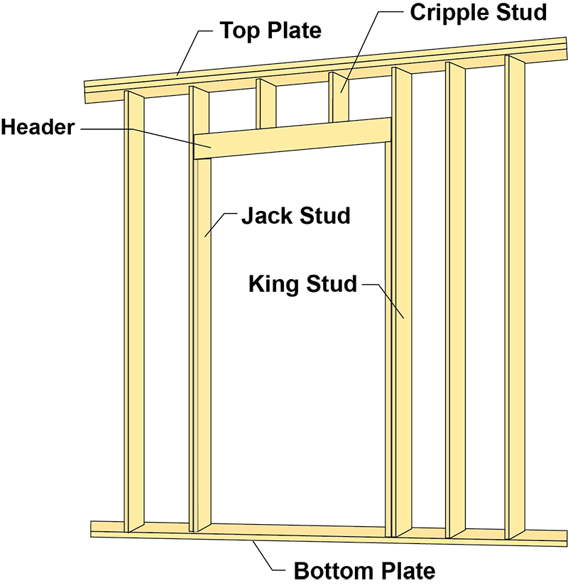

# Wall Panels — scope и исключения

Wall panel — изготовленный заранее участок деревянной стены. В нём могут быть
studs, plates, framing проёмов, sheathing и WRB. Конкретный состав определяет
поставка: слово `panels` не гарантирует, что включены все слои и connections.
По SBCA панели применяются для exterior и interior walls; placement diagram
задаёт положение каждой панели.
[SBCA: Wall Panels](https://www.sbcacomponents.com/wall-panels).

<figure markdown>
  { width="760" style="background:#fff;padding:12px;border-radius:8px" }
  <figcaption>Состав wall panel. Иллюстрация SBCA; наличие элемента на схеме не подтверждает его включение в конкретную поставку.</figcaption>
</figure>

## Наши правила E-Wood

Это правила состава сметы команды, подтверждённые владельцем 2026-10-09.
Они не являются утверждением, что такую стену технически невозможно сделать
на заводе.

| Участок | Что делаем в расчёте |
| --- | --- |
| Обычная стена, включённая в wall panel package by others | Не дублируем её заводской каркас. Считаем согласованный loose scope. |
| **Стена под concrete slab / podium** | **Считаем как stick framing**, даже если проект в целом `COM w/panel`. В DFL сохраняем studs, plates, headers и применимую sheathing. |
| **Новая/заменяемая стена внутри existing frame при reconstruction** | **Считаем stick framing** по объёму новой работы. Общая пометка panels не исключает этот участок. |
| Короткая стена или irregular sloped wall | Отдельное non-panel исключение; считаем соответствующий stick scope. |
| Exterior build-up wall | Возможное non-panel исключение. Проверяем конструкцию и scope, не исключаем все build-ups автоматически. |
| Wood-framed wall рядом с CMU | Может быть panelized. Соседство с CMU не является основанием для optional stick framing. |
| Furring strips под insulation/siding | Отдельные рейки/профили по detail и scope; не смешиваем с полноценной furring wall. |
| Shaft / elevator | Всегда фиксируем стену в takeoff; определяем материал и package. Нельзя забыть shaft из-за общего `panels by others`. |

**«Под бетоном» и «на бетоне» различаются.** Наше исключение относится к
деревянным стенам ниже concrete slab/podium. Стена, которая просто стоит
нижней plate на бетонном основании, может быть panelized. SBCA описывает
PT bottom plate для такого опирания; это не основание считать всю стену stick.
[SBCA: Bottom Plate](https://www.sbcacomponents.com/wall-panels).

Для mixed здания определяем границу по разрезам. Base/Basement/1st Floor
участки **фактически ниже плиты** оставляем stick; этажи выше относятся к
panel scope по проекту. Одно имя этажа не доказывает положение относительно
бетона. Нельзя одним действием убрать stick blocks со всех этажей.

## Как установить состав panel package

Сверь четыре источника: project scope/письмо клиента, structural/architectural
details, wall schedule и предложение/чертежи изготовителя panels. Для каждой
позиции фиксируй одно из трёх: `included in panels`, `loose — count`,
`verify scope`. Так остаётся видимым, кто поставляет материал.

| Элемент | Проверка перед отдельным подсчётом |
| --- | --- |
| Studs, plates, in-panel blocking, corners | Включены в package? Тогда повторный material count не нужен. В stick exceptions считаем полностью. |
| Headers, king/jack/cripple studs | Проверяем openings и panel drawings. Название `special/flush header` само по себе не доказывает loose scope. |
| Sheathing / shear plywood | Проверяем, какой слой и какая сторона включены; отдельные loose зоны считаем по details. Не назначаем всем shear walls одну сторону. |
| WRB/Tyvek, insulation, exterior gypsum | Могут входить в поставку или оставаться field scope. Не дублируем и не исключаем без проверки. |
| Sill plates, gasket, anchors, holdowns, straps | Сверяем отдельные connections и supply responsibility; заводской каркас не закрывает эту проверку. |
| Double top plate / splice material | Часть может устанавливаться в поле. Проверяем supplied loose material и соединения панелей. |
| Floor-height/box sheathing, truss heel, parapet, gable, roof edge | Проверяем каждый узел отдельно: это не автоматически часть wall panel. |
| Beams, posts, hangers, ledgers | Проверяем свой structural schedule и scope; не теряем их из-за `panels by others`. |
| Temporary / permanent bracing | Разделяем назначения и следуем проекту/installation plan; учитываем материал в пределах заказанного scope. |

SBCA подтверждает, что sheathing/WRB могут наноситься на заводе, а соединяющая
верхняя plate может монтироваться на объекте. Поэтому таблица выше —
проверка поставки, не универсальный перечень включённого материала.
[SBCA: элементы и сборка panels](https://www.sbcacomponents.com/wall-panels).

## Reconstruction: existing не равно «ничего не считать»

- Существующую неизменяемую конструкцию не пересчитываем как новую.
- Считаем новые стены, замену, reinforcement, connections и заданные покрытия.
- Если detail требует **new subfloor over all existing flooring**, включаем
  всю указанную площадь нового слоя, даже при сохранённом старом настиле.
- Пристройка/новый корпус и ремонт внутри existing frame могут иметь разный
  scope. Не распространяем panel исключение или stick правило на весь job
  только из-за слова `reconstruction` в названии.
- Показываем отдельно `existing to remain`, `new`, `replace`, `patch` и
  соединения new-to-existing. Подробно: [Reconstruction](../../../work-types/reconstruction.md).

## Проверка чертежей и монтажа

Для takeoff полезно сверить номера panels, размеры rough openings, высоты,
толщины, bearing points и сопряжения с полом/крышей. Разница между panel
drawings и строительными plans становится вопросом для уточнения.

Руководство SBCA отдельно требует устойчивости/временного раскрепления стен
во время монтажа и ограничивает самовольные изменения panels. Для сметы это
означает: проверять bracing и connection details, а не придумывать раскрой
или замену несущих элементов.
[SBCA: Handling, Installing & Temporary Bracing](https://api.sbcacomponents.com/sites/default/files/handling-installing-temporary-bracing-wall-panels_7.pdf).

## Notes для выдачи

- `Walls below concrete podium counted as stick framing; wall panels above by others.`
- `New walls within existing frame counted as stick framing.`
- `Wall panel package by others; loose materials listed separately per scope.`
- Если участок действительно полностью предполагается: укажи **почему**,
  какой материал принят и что проверить. Не называй shown framing `Optional`
  только из-за отсутствующего spacing.

## Чек-лист

- [ ] Panel и stick участки разделены по этажам и разрезам.
- [ ] Стены под плитой и новые стены внутри existing frame посчитаны.
- [ ] CMU adjacency не превращён в автоматическое non-panel исключение.
- [ ] Shaft walls записаны; материал и supply scope определены.
- [ ] Included material не продублирован; loose material не пропущен.
- [ ] Headers, shear layers, holdowns и connections проверены по своим details.
- [ ] Notes объясняют реальные assumptions и границы scope.

## See also

- [COM Commercial](../../../work-types/com.md)
- [Furring](furring.md)
- [Exterior Walls](exterior.md)
- [Reconstruction](../../../work-types/reconstruction.md)
- [Советы и важные вещи](../../../reference/boss-feedback-rules.md#wall-panels)
